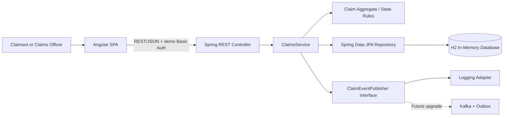
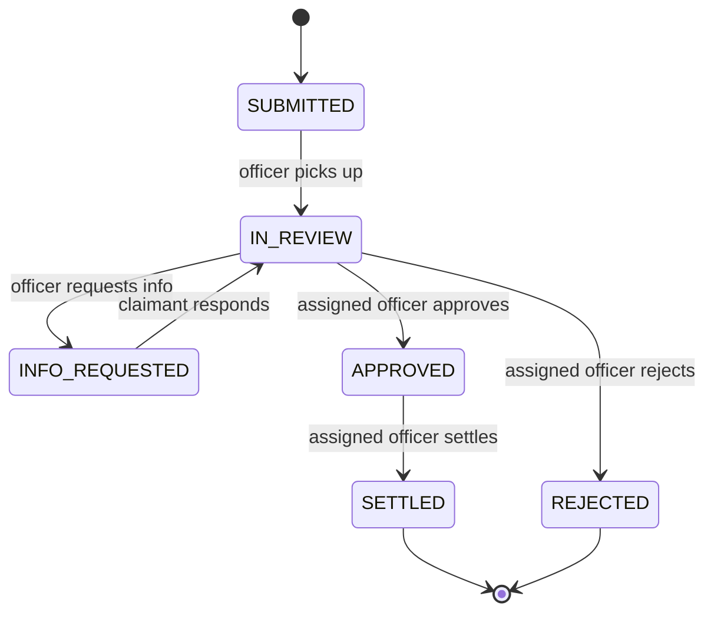
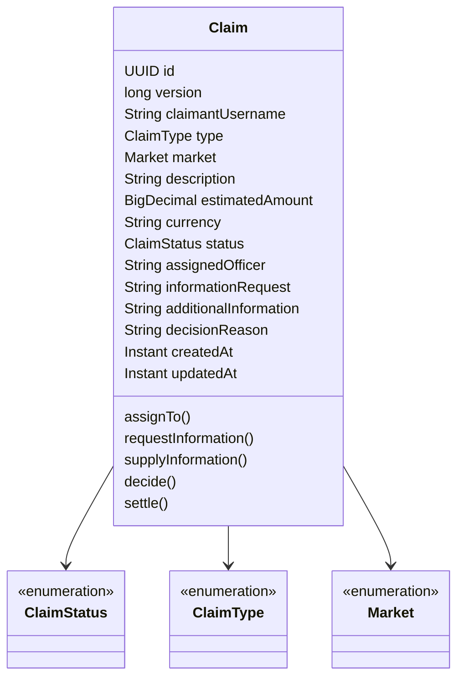

# APAC Claims Hub

> **Chubb APAC full-stack take-home assessment | Java 21 + Spring Boot 3.4.5 + Angular 19**  
> **Assessment status:** engineering demonstration, not production software. **Test status:** code and test sources provided; end-to-end build could not be executed in this authoring environment (no Maven installation, Docker executable, or npm registry connectivity). Run the commands below before submitting and commit the actual results.  
> **Confidentiality:** The assessment brief is marked *Internal*. Do not publish the brief or share a repository publicly without the hiring panel's permission.

## 1. Executive overview

The business problem: claimants currently report motor and property incidents through disjointed channels, lack tracking visibility, and staff cannot efficiently see their workload or outstanding liabilities. This application supplies one Angular frontend with separate claimant and claims-officer experiences, backed by one Spring Boot API and a relational persistence model.

**Implemented scope**
- Claimant: submit motor/property claims; list and track own submissions; respond when a claims officer requests additional information; view approval/rejection outcomes.
- Staff: see all incoming claims; pick up unassigned claims; request information; approve or reject assessed claims; mark approved claims settled.
- Management view for staff: six-state workload counts and outstanding exposure **by market and original currency**, never a meaningless cross-currency sum.
- HTTP Basic authentication for four **demo-only** users; backend role checks and owner/assignee authorization; Bean Validation; optimistic locking (`@Version`); domain state invariants.
- Event-publisher abstraction with structured logging implementation: a deliberate seam for Kafka, not a false claim of distributed event delivery.
- Domain unit tests and Spring MVC integration tests included.

**Deliberately excluded**: document uploads, external notifications, real payment processing, FX conversion, actuarial incurred-but-not-reported reserves, assignment transfers, audit-grade history, distributed Kafka infrastructure, enterprise IAM, and production durability. Details under [Limitations](#12-limitations-and-next-iterations).

## 2. Problem understanding and assumptions

Source: the provided *Chubb APAC Engineering Fullstack Developer Take-Home Assessment* (4 pages). It specifies Angular; Java/Spring Boot or .NET; discretion over REST and Kafka; backend-first delivery; a **2–3 hour target and 5-hour hard cap**; meaningful commit history; an AI working journal; and a panel walkthrough.

Interpretations (not mandated by the brief):

| ID | Decision / assumption | Rationale |
|---|---|---|
| A01 | Markets AU, SG, HK, MY, TH, VN are illustrative | Brief says six markets but does not name them. Confirm with business. |
| A02 | Currency is inferred from market (AUD, SGD, HKD, MYR, THB, VND) | Avoid mixed-currency exposure calculations. |
| A03 | Claimed estimated amount represents *provisional reported exposure* | It is not a booked reserve or settlement amount. |
| A04 | Every newly submitted claim is `SUBMITTED`; an officer picks it up | Transparent, auditable simple workflow. |
| A05 | Assigned officer exclusively progresses that claim | Prevent concurrent officers from issuing conflicting decisions. |
| A06 | Claimant may provide additional information only when explicitly requested | Enforces workflow and permission limits. |
| A07 | Rejected and settled claims no longer contribute to outstanding estimated exposure | Demo reporting rule, not an insurance accounting standard. |
| A08 | Staff can see all claims; claimants see only theirs | Minimal role model for the demonstration. |
| A09 | H2 in-memory DB resets on restart | Simplifies assessment startup; production needs PostgreSQL + migrations. |
| A10 | Demo Basic auth and client storage of Basic credentials are **non-production** shortcuts | Replace with OIDC Authorization Code + PKCE, BFF/session or token handling and HTTPS. |

## 3. Architecture



**Modular monolith** chosen for fast local setup, transactional workflow, low operational overhead, and clear service boundaries. No need for a service network in a 5-hour take-home. Separation at `api`, `domain`, `service`, `infrastructure`, and `config` is intentional; a future claims/notifications/analytics split can use stable event boundaries.

**Backend modules**
- `api`: REST controller, DTOs, validation, error response mapping.
- `domain`: claim aggregate; types, markets, lifecycle state machine, actor invariants.
- `service`: transaction orchestration, authorization-dependent use cases, exposure projection, event port.
- `infrastructure`: Spring Data repository and log-based event adapter.
- `config`: basic auth users, role authorization and CORS.

**Frontend modules**
- `core/models.ts`: API types; `core/claims-api.service.ts`: HTTP facade; `core/auth.service.ts` + interceptor: demo auth; `app.component`: role-dependent assessment UI.
- In an expanded implementation, split role screens into lazy-loaded feature routes and add reactive-form validation and state management; avoided premature complexity here.

### State transition model



Invalid transitions return HTTP **409 Conflict**. Only the assigned officer can take subsequent officer actions; only the owning claimant may supply information. `@Version` supplies optimistic locking, rejecting conflicting writes rather than silently losing an update. The current API does not expose explicit `If-Match` preconditions; that is a recommended follow-up.

### Domain model



### REST versus Kafka

| Communication | Choice | Why |
|---|---|---|
| Browser creation, retrieval and mutation | Synchronous REST/JSON | Immediate confirmation, standard browser support, predictable status errors. |
| Officer dashboard | REST read projection | Small dataset and simple current-snapshot query. |
| Downstream alerts, analytics, settlement integration | Eventually Kafka events | Async work must not delay user response; replay/backpressure and independent consumers help at scale. |
| Implemented today | `ClaimEventPublisher` → logging adapter | Demonstrates abstraction without pretending Kafka is running. |

**Critical production note:** Current event logging is performed inside the service transaction and is **not guaranteed delivery**. For real Kafka, persist an outbox event in the same DB transaction, publish by a background worker / CDC, use idempotent consumers and retries + dead-letter topics; never publish a business-critical event without an atomicity strategy.

## 4. Design patterns and SOLID

| Concept | Application in code | Explanation |
|---|---|---|
| State machine | `domain/Claim.java` | Operations encode legal transitions; no controller-owned business state switches. |
| Repository | `infrastructure/ClaimRepository.java` | Storage abstraction via JPA. |
| Ports and adapters / Strategy | `service/ClaimEventPublisher.java`, `infrastructure/LoggingClaimEventPublisher.java` | Replace notification/event implementation without changing use cases. |
| DTO / API contract | `api/ClaimsDto.java` | Persistence models are not serialized directly. |
| Dependency Injection | `ClaimsService` constructor | Dependencies supplied from outside, allowing tests and replacement. |
| SRP | Controller handles transport, aggregate handles invariants, service orchestrates, repository persists | A class has a primary reason to change. |
| OCP | Implement another `ClaimEventPublisher` | New behavior via additional adapter rather than rewriting service. |
| LSP | Event publisher implementations meet the same method contract | Interchangeable implementations. |
| ISP | One small event publisher interface | No forced dependence on unused interface methods. |
| DIP | Service depends on event port, not logging implementation | Domain workflow remains infrastructure-agnostic for events. |

**Avoiding overengineering:** No gratuitous Factory/Singleton/AbstractFactory classes. Enums and aggregate methods are more readable than a forest of trivial strategies for a six-state claim flow.

## 5. Requirements traceability

| Brief expectation | Implementation | Coverage |
|---|---|---|
| Claimant reports incident | `POST /api/claims`, Angular form | Implemented |
| Claimant tracks claim | `GET /api/claims`, status badges | Implemented |
| Claimant provides requested info | `POST /api/claims/{id}/provide-info` | Implemented |
| Claimant receives decisions | Decision status and reason in UI | In-app visibility; no push/email |
| Staff picks up incoming work | `POST /api/claims/{id}/assign` | Implemented |
| Staff reviews/assesses | Read fields, request further info | Basic workflow |
| Staff progresses settlement/rejection | `/decision` and `/settle` | Implemented; no payout |
| Staff sees team workload | `/dashboard` counts and shared queue | Basic view |
| Managers see liability exposure | `/dashboard` grouped totals | Provisional estimation only |
| One Angular application serves both | Role-based rendering | Implemented |
| Sync vs event-driven decision | REST + event port | Documented; Kafka not deployed |
| Local startup | Docker Compose or local Java/Node | Configuration provided |
| AI working journal | `docs/ai-journal/README.md` | Provided, factual limitations noted |
| Panel walkthrough | `docs/WALKTHROUGH.md` | Prepared |

## 6. Getting started

### Recommended: Docker Compose

**Prerequisites:** Docker Engine/Compose v2, network access for initial base-image and dependency downloads.

```bash
docker compose up --build
```

Open **http://localhost:4200**. Backend at **http://localhost:8080/api**. Both containers communicate using the Docker `backend` network hostname and the Angular dev-server proxy. On first run Docker downloads dependencies; startup within five minutes is a *goal*, not a validated guarantee in this environment.

```bash
docker compose down
```

### Local developer setup

**Prerequisites:** JDK 21, Maven 3.9+, Node.js 22, npm 10+, registry/network access on first install.

Terminal 1:
```bash
cd backend
mvn clean spring-boot:run
```

Terminal 2:
```bash
cd frontend
npm install
npm start
```

Frontend runs at `http://localhost:4200` and proxies `/api` to the backend at `localhost:8080`. H2 is recreated every application restart.

### Demo accounts

| Login | Password | Role |
|---|---|---|
| `claimant1` | `demo123` | Claimant |
| `claimant2` | `demo123` | Claimant |
| `officer1` | `demo123` | Claims staff |
| `officer2` | `demo123` | Claims staff |

These are hard-coded assessment credentials, **not production defaults**. Use localhost only. Credentials are transmitted via HTTP Basic and temporarily held in browser `sessionStorage` as base64, **not encryption**.

### Demo workflow

1. Sign in as `claimant1`; submit a `MOTOR` claim in `SG`, estimate 2,500 SGD.
2. Sign out; sign in as `officer1`; open claim queue and **Pick up claim**.
3. Select **Request info**; enter `Provide police report reference`.
4. Sign in again as `claimant1`; select **Provide information** and respond.
5. Sign in as `officer1`; **Approve** with a reason, then **Mark settled**.
6. Observe dashboard transition counts and exposure removal on settlement.
7. Repeat a claim and choose **Reject** to show the alternate terminal path.
8. Try accessing another claimant's data, using `claimant2`, to demonstrate isolation.

## 7. API reference

All API paths are under `/api`; all require HTTP Basic credentials. Use `Content-Type: application/json` for JSON requests.

| Verb | Endpoint | Role | Body / behavior | Success |
|---|---|---|---|---|
| GET | `/me` | Any | Identity and role | 200 |
| GET | `/claims` | Any | Claimants: own records; staff: all | 200 |
| GET | `/claims/{id}` | Owner or staff | Single claim | 200 |
| POST | `/claims` | Claimant | `type`, `market`, `description`, `estimatedAmount` | 201 |
| POST | `/claims/{id}/assign` | Staff | Pick up new claim | 200 |
| POST | `/claims/{id}/request-info` | Assigned staff | `{"text":"..."}` | 200 |
| POST | `/claims/{id}/provide-info` | Owner claimant | `{"text":"..."}` | 200 |
| POST | `/claims/{id}/decision` | Assigned staff | `{"approved":true,"reason":"..."}` | 200 |
| POST | `/claims/{id}/settle` | Assigned staff | No body | 200 |
| GET | `/dashboard` | Staff | Counts and grouped exposure | 200 |

`type`: `MOTOR` or `PROPERTY`; `market`: `AU`, `SG`, `HK`, `MY`, `TH`, `VN`. Estimated amount must be greater than zero and fit 16 whole digits plus 2 decimals.

**Response shape** (example, variable UUIDs/timestamps omitted):

```json
{
  "id": "00000000-0000-0000-0000-000000000000",
  "version": 0,
  "claimantUsername": "claimant1",
  "type": "MOTOR",
  "market": "SG",
  "description": "Rear-end collision",
  "estimatedAmount": 2500.00,
  "currency": "SGD",
  "status": "SUBMITTED",
  "assignedOfficer": null,
  "informationRequest": null,
  "additionalInformation": null,
  "decisionReason": null,
  "createdAt": "2026-11-05T09:00:00Z",
  "updatedAt": "2026-11-05T09:00:00Z"
}
```

**Errors:** 400 validation failure; 401 unauthenticated; 403 unauthorized; 404 unknown claim; 409 invalid lifecycle operation. Concurrency conflicts use JPA optimistic-lock exceptions and are not yet normalized into a stable 409 error contract.

**Example using cURL**
```bash
curl -u claimant1:demo123 -H 'Content-Type: application/json' \
  -d '{"type":"MOTOR","market":"SG","description":"Minor collision","estimatedAmount":2500.00}' \
  http://localhost:8080/api/claims

curl -u officer1:demo123 http://localhost:8080/api/dashboard
```

**Expected dashboard fragment** (for a newly created 2,500 SGD claim):
```json
{"submitted":1,"inReview":0,"awaitingInfo":0,"approved":0,"rejected":0,"settled":0,"exposure":[{"market":"SG","currency":"SGD","amount":2500.00,"outstandingCount":1}]}
```

## 8. Data integrity and security

- State transitions enforced in aggregate, not only UI; UI is never an authority.
- `@Version` to prevent silent write overwrites in concurrent updates.
- `BigDecimal` for currency amount; never binary floating point for backend money.
- Reject unknown types/markets and empty incident descriptions via validated request DTOs.
- Claimant listing and single-item reads restricted to owner. Staff mutations require staff role and assigned officer.
- Passwords encoded using bcrypt in the demo in-memory identity store.
- Explicit local CORS origin `http://localhost:4200`.
- No production data, PII, payment information, or actual claim documents should be entered.

**Known security debt:** Basic auth over localhost HTTP; demo credentials shipped in source; `sessionStorage` exposes auth to any successful XSS; CSRF globally disabled (stateless demo request model); no API rate-limits, audit trail, security headers policy, token expiry or TLS. These must be fixed before real deployment.

## 9. Testing and verification

### Backend tests

```bash
cd backend
mvn test
mvn clean verify
```

Included test coverage:
- `ClaimWorkflowTest`: happy path including info request; illegal direct decision; wrong officer and wrong claimant blocked; currency market mapping.
- `ClaimsApiTest`: no-auth rejection; authenticated claim creation; staff dashboard; claimant dashboard forbidden; invalid creation rejected.

### Frontend build checks

```bash
cd frontend
npm install
npm run build
```

**Explicit evidence statement:** Source files were generated, but the environment used to assemble this submission has JDK 21 and Node 22 **without Maven, Docker or an accessible package registry**. Thus I cannot honestly claim the Maven tests passed, the Angular compilation passed, or that the full stack has been demonstrated live. **Do not submit until the actual commands succeed on your machine.** Capture the output in the final verification section below.

| Check | Status here | What to record before delivery |
|---|---|---|
| Backend unit tests | NOT RUN | Actual test count and failures |
| Backend API tests | NOT RUN | Actual results |
| Angular production build | NOT RUN | Build completion and warnings |
| Docker Compose startup | NOT RUN | Successful containers and URL |
| Manual E2E demo | NOT RUN | Claimant → officer → decision → settlement |
| Access-control negative test | NOT RUN | 403/401 expectations |

### Manual acceptance checklist

- [ ] `claimant1` submits a claim and sees `SUBMITTED`.
- [ ] `claimant2` cannot view `claimant1` claims in list or single-record endpoint.
- [ ] `officer1` assigns it; `officer2` cannot decide it.
- [ ] Officer requests information; claimant responds; state returns to `IN_REVIEW`.
- [ ] Approval and settlement occur in order; illegal transition returns 409.
- [ ] Rejection appears to claimant with reason.
- [ ] Outstanding exposure is grouped per market/currency, with no cross-currency sum.
- [ ] Rejected/settled records are omitted from outstanding exposure.
- [ ] Fresh-start procedure works from README without extra undocumented steps.

## 10. SDLC process and delivery approach

| Phase | Evidence / output |
|---|---|
| Discovery | Requirement matrix and assumptions A01–A10 above |
| Architecture | Modular monolith, state machine, synchronous/asynchronous boundaries |
| Implementation | Spring Boot domain/application/API + Angular role-based UI |
| Verification | Unit/integration test source + manual checklist; execution pending |
| Security review | Authorization, validation, secure-by-design gaps identified |
| Release | Dockerfiles, Compose, local runbook and README |
| Retrospective | AI journal and `docs/WALKTHROUGH.md`; follow-up roadmap |

For an actual timed 5-hour take-home, suggested allocation: ~20 minutes requirements and architecture, ~100 minutes backend workflow/API, ~35 minutes tests, ~40 minutes Angular, ~30 minutes documentation and verification, leaving buffer. **This is a plan, not a claim about elapsed work.**

### Commit plan

Meaningful history should represent **real development**; do not fake timestamps or claim commits were made if no Git repository exists. Suggested sequence for an actual local repository:

```bash
git init
# commit after each real milestone, verifying changes before committing
git add . && git commit -m "docs: define scope, assumptions and architecture"
# later commits as work is actually completed:
# feat(domain): enforce claims lifecycle and ownership rules
# feat(api): expose secure claim workflow endpoints
# test: cover state transitions and API authorization
# feat(ui): provide claimant and staff claim flows
# docs: record AI decisions and walkthrough
```

**Note:** Initial file bundle is a snapshot; it is not evidence of a meaningful pre-existing Git history. The reviewer should see genuine commits made as the work evolves.

## 11. AI usage and engineering decision record

See [`docs/ai-journal/README.md`](docs/ai-journal/README.md) and [`docs/architecture/ADR-001.md`](docs/architecture/ADR-001.md).

The journal distinguishes the user's instruction from architecture/code-generation decisions and makes clear that AI output still requires developer validation. It does **not** pretend that all tests were run or invent AI interactions not recorded in the conversation.

## 12. Limitations and next iterations

**P0 before submission:** Run and fix tests/build, execute end-to-end demo, normalize optimistic lock conflict handling, add at least one direct integration test for end-to-end lifecycle and authorization, inspect container logs.

**P1 production-readiness:** PostgreSQL + Flyway, formal auth (OIDC + PKCE), secure secrets/HTTPS, OpenAPI schema, server-side pagination/filtering, audit history, accessibility review and better Angular form UI, distributed tracing.

**P2 scale/event integration:** Transactional outbox + Kafka + idempotent consumers, notifications, settlement/payment integrations, query optimizations, real currency conversion with explicit rate timestamps, multi-market RBAC and tenant isolation.

**P3 domain sophistication:** Reserve estimates distinct from claimed amount, claim attachments with antivirus/object storage, fraud signals, configurable SLAs, reassignment/escalations, immutable ledger and financial reconciliation.

### Engineering trade-offs to defend

1. **One service vs microservices:** Service boundaries must earn their complexity; start modular and extract on scaling/ownership constraints.
2. **H2 vs PostgreSQL:** Fast zero-setup demo; not durable, operationally representative, or suitable for real claims.
3. **REST vs Kafka:** User commands need immediate acceptance/error; events benefit future integrations, but Kafka not necessary for first cut.
4. **No FX aggregation:** Adding AUD + SGD totals is misleading. Reporting must preserve currencies unless an explicit conversion policy exists.
5. **No heavyweight state pattern framework:** Aggregate methods capture a small lifecycle with discoverable invariants; revisit only if rules become configurable or complex.
6. **Partial async model:** Logging adapter demonstrates a seam; it is not a trustworthy event bus and must not be marketed as such.
7. **Frontend compactness:** Prioritized the backend as explicitly requested; Angular still demonstrates one codebase for both roles.

## 13. Repository layout

```text
chubb-claims-platform/
├── README.md                         # Primary reviewer entry point
├── docker-compose.yml                # One-command orchestration
├── .gitignore
├── backend/
│   ├── Dockerfile
│   ├── pom.xml
│   └── src/
│       ├── main/java/com/chubb/claims/
│       │   ├── ClaimsApplication.java
│       │   ├── api/                   # Controller, API DTOs, error mapping
│       │   ├── domain/                # Aggregate, statuses, types, market
│       │   ├── service/               # Use cases + event port
│       │   ├── infrastructure/        # JPA and event adapter
│       │   └── config/                # Security + CORS
│       ├── main/resources/application.yml
│       └── test/java/com/chubb/claims/ # Domain and HTTP integration tests
├── frontend/
│   ├── Dockerfile
│   ├── angular.json
│   ├── package.json
│   ├── proxy.conf.json
│   ├── proxy.docker.conf.json
│   └── src/
│       ├── app/core/                 # DTO models, API + auth services
│       ├── app/app.component.ts
│       ├── app/app.component.html
│       ├── index.html
│       └── styles.css
└── docs/
    ├── architecture/ADR-001.md
    ├── ai-journal/README.md
    └── WALKTHROUGH.md
```

## 14. Panel preparation

See [`docs/WALKTHROUGH.md`](docs/WALKTHROUGH.md) for a guided 15–20 minute presentation, trade-off Q&A, and ten-minute more-time roadmap. **The author of the submission is accountable for every line of code and every engineering claim.**
